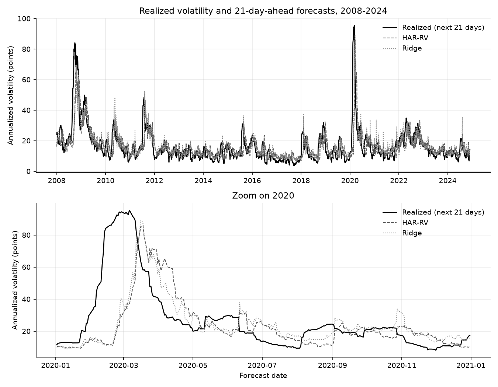
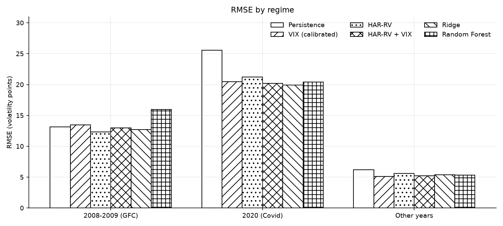

# Forecasting S&P 500 realized volatility 21 days ahead

Out-of-sample over 2008-2024 (annual walk-forward, 21-day purge), HAR-RV significantly beats a persistence baseline; adding the VIX or switching to Ridge/Lasso lowers RMSE from 8.40 to 8.16-8.24, but not significantly (Diebold-Mariano), and tree-based models do worse.

## Problem

Forecast the annualized realized volatility of the S&P 500 over the next 21 trading days, using the VIX and past realized volatility known at the close of day t. The point is not to find a model that wins, but to measure honestly how much each added ingredient (VIX, regularization, non-linearity) improves on simple, hard-to-beat baselines.

## Data

- Daily closes of `^GSPC` and `^VIX` from Yahoo Finance (`yfinance`, `auto_adjust=True`), 2000-2024. The download is cached in `data/spx_vix_close.csv`, so results do not depend on Yahoo being available.
- 6,245 usable observations (2000-02-03 to 2024-11-27); the last 21 days of 2024 have no complete target and are dropped, never imputed.
- Target, with `r` the daily log return:

  `y(t) = sqrt( mean( r(t+1)^2 .. r(t+21)^2 ) ) * sqrt(252) * 100`

  This is a zero-mean estimator (no demeaning, no ddof correction), in volatility points, directly comparable with the VIX. It is not `pandas.Series.std()`; see Limitations.

## Method

**Features** (all known at the close of t; a test checks that perturbing returns after t leaves every feature at t unchanged):
- HAR components (Corsi, 2009): daily (1 day), weekly (5 days) and monthly (22 days) realized volatility, built with the same zero-mean estimator as the target. The daily component is `|r(t)| * sqrt(252) * 100`.
- Realized volatility over the last 21 days (used by the persistence baseline).
- VIX at t, its lags 1, 5 and 21, its previous-day change, `log(VIX)` and `VIX^2`.

**Models**, from simplest to most complex:
1. Persistence: the realized volatility of the last 21 days, same convention as the target.
2. Raw VIX: `y(t) = VIX(t)`.
3. Calibrated VIX: OLS `a + b * VIX(t)`.
4. HAR-RV: OLS on the daily, weekly and monthly components.
5. HAR-RV + VIX.
6. Ridge and Lasso on all features. A `StandardScaler` is fitted on the training window only; the penalty is chosen by `TimeSeriesSplit(n_splits=5, gap=21)` inside the training window, on a log grid from 1e-4 to 1e3. The retained penalty is saved per fold (`results/alphas_by_fold.csv`); it never sat on the lower bound of the grid (0 of 34 fits).
7. Random Forest (500 trees, `min_samples_leaf=20`, `max_features="sqrt"`) and Gradient Boosting (300 trees, learning rate 0.05, depth 3, `subsample=0.8`). Hyperparameters are fixed in advance, `random_state=42`, no tuning on the test set.

All forecasts are floored at 1 volatility point so that QLIKE is defined (no forecast was actually raised by the floor).

**Walk-forward protocol.** For each test year from 2008 to 2024, every model is refitted on all data up to 31 December of the previous year, minus the last 21 observations. Those 21 observations have targets that extend into the test year, so keeping them would leak test-period information into training (purge). The test set is the full year; 4,257 forecasts in total.

**Metrics**, aggregated over all out-of-sample forecasts:
- RMSE and MAE, in volatility points.
- R2 out-of-sample relative to persistence: `1 - MSE_model / MSE_persistence`.
- QLIKE (Patton, 2011) on variances: with `s2 = (RV/100)^2` and `h = (forecast/100)^2`, `QLIKE = mean( s2/h - ln(s2/h) - 1 )`. Lower is better.

**Diebold-Mariano tests.** Three comparisons, fixed before the results were read, each on squared error and on QLIKE: HAR + VIX vs HAR, the best ML model vs HAR + VIX, and HAR vs Persistence. The variance of the loss differential is Newey-West with 20 lags (horizon minus one, because consecutive 21-day targets overlap), with the Harvey-Leybourne-Newbold small-sample correction and a Student t(n - 1) reference distribution. The "best ML model" is the one with the lowest aggregate RMSE among Ridge, Lasso, Random Forest and Gradient Boosting, which is Ridge (see Limitations).

## Results

Out-of-sample, 2008-2024 (n = 4,257). Lower is better for RMSE, MAE and QLIKE.

| Model | RMSE | MAE | R2 vs persistence | QLIKE |
|---|---|---|---|---|
| Persistence | 9.53 | 5.64 | 0.000 | 0.589 |
| VIX (raw) | 8.90 | 6.30 | 0.128 | 0.377 |
| VIX (calibrated) | 8.26 | 4.70 | 0.248 | 0.406 |
| HAR-RV | 8.40 | 5.11 | 0.224 | 0.416 |
| HAR-RV + VIX | 8.16 | 4.70 | 0.266 | 0.404 |
| Ridge | 8.16 | 4.76 | 0.267 | 0.392 |
| Lasso | 8.24 | 4.76 | 0.253 | 0.393 |
| Random Forest | 8.85 | 5.02 | 0.138 | 0.443 |
| Gradient Boosting | 9.56 | 5.33 | -0.006 | 0.473 |

By regime, RMSE (QLIKE in brackets). The ranking changes from one regime to the next.

| Model | 2008-2009 (n = 505) | 2020 (n = 253) | Other years (n = 3,499) |
|---|---|---|---|
| Persistence | 13.16 (0.317) | 25.55 (2.287) | 6.19 (0.506) |
| VIX (raw) | 12.95 (0.332) | 20.67 (1.450) | 6.42 (0.306) |
| VIX (calibrated) | 13.49 (0.449) | 20.49 (2.151) | 5.14 (0.274) |
| HAR-RV | 12.32 (0.339) | 21.24 (2.074) | 5.59 (0.308) |
| HAR-RV + VIX | 13.01 (0.403) | 20.22 (2.163) | 5.21 (0.277) |
| Ridge | 12.69 (0.382) | 19.93 (1.902) | 5.38 (0.284) |
| Lasso | 13.19 (0.412) | 20.02 (1.912) | 5.34 (0.281) |
| Random Forest | 15.95 (0.556) | 20.41 (2.314) | 5.33 (0.291) |
| Gradient Boosting | 16.79 (0.674) | 21.46 (2.397) | 6.09 (0.305) |

Diebold-Mariano tests. Sign convention: a statistic below 0 means model A has a lower loss than model B. The statistic includes the HLN correction; p-values are two-sided.

| A | B | Loss | Mean loss diff (A - B) | DM stat | p-value |
|---|---|---|---|---|---|
| HAR-RV + VIX | HAR-RV | squared error | -3.85 | -1.26 | 0.206 |
| HAR-RV + VIX | HAR-RV | QLIKE | -0.012 | -0.66 | 0.507 |
| Ridge | HAR-RV + VIX | squared error | -0.11 | -0.08 | 0.933 |
| Ridge | HAR-RV + VIX | QLIKE | -0.012 | -0.79 | 0.429 |
| HAR-RV | Persistence | squared error | -20.33 | -2.17 | 0.030 |
| HAR-RV | Persistence | QLIKE | -0.173 | -4.50 | 7e-6 |



*The realized series is plotted at the forecast date t, so it covers t+1 to t+21 and leads the forecasts by construction. The 2020 zoom shows that no model anticipates the Covid shock: forecasts only react once it shows up in the VIX and in past returns.*



Further figures are in `results/`: RMSE and QLIKE by model (`fig2_rmse_qlike.png`) and RMSE by test year (`fig3_rmse_by_year.png`).

### Interpretation

1. **Only HAR > Persistence is significant.** It holds on both losses. Every other comparison planned in advance (VIX added to HAR, Ridge vs HAR + VIX) is not significant. Differences in RMSE between HAR, HAR + VIX, Ridge and Lasso should not be read as gains. Lasso was not part of a pre-specified test.
2. **The VIX is highly significant in sample but brings no significant out-of-sample gain.** In a 2000-2007 fit with Newey-West standard errors (21 lags), adding the VIX to HAR raises R2 from 0.50 to 0.63, the VIX coefficient is 0.80 (t = 6.6), and the HAR components lose their significance. Out of sample, HAR + VIX vs HAR is not significant (p = 0.21 on squared error, p = 0.51 on QLIKE). With roughly 200 independent observations (4,257 / 21), the tests have little power.
3. **Raw VIX is best on QLIKE but not on RMSE.** The raw VIX over-forecasts realized volatility on average (mean error +3.55 points; it forecasts below the realized value on 17% of days, against 37% to 48% for the other models). This is the variance risk premium. QLIKE penalizes under-forecasting more than over-forecasting, so a forecast that is biased upward is penalized less on QLIKE than on RMSE. Hypothesis, not tested: that this asymmetry explains the ranking. The raw VIX is the best model on QLIKE in 2020 but ranks 7th of 9 in the other years, so the aggregate QLIKE is driven by the stress episodes.
4. **Random Forest and Gradient Boosting do worse than the linear models** (RMSE 8.85 and 9.56 vs 8.16 to 8.40; QLIKE 0.443 and 0.473 vs 0.392 to 0.416). Gradient Boosting does not even beat persistence on RMSE (R2 vs persistence -0.006). The gap comes mostly from 2008-2009, where both do worse than persistence. In the other years Random Forest (5.33) is close to HAR + VIX (5.21). Hypothesis, not tested: trees cannot extrapolate beyond the range of volatility seen in training, and the 2008 levels exceed those of 2000-2007. No test was run on this.
5. **The daily HAR coefficient is close to zero** (0.015, t = 1.7 in HAR; about 0 in HAR + VIX). Here the daily realized volatility is one squared return, with no intraday data, unlike in Corsi (2009). It is a very noisy measure of the day's variance. Hypothesis, not tested: measurement error in a regressor biases its coefficient toward zero (attenuation).

## Limitations

- **Zero-mean vs `std` convention.** The target is the zero-mean estimator, not `rolling().std()`. The two correlate at 0.999 but differ by up to 3.84 volatility points on individual dates (36% of the target's standard deviation), and by about 1.2% on the level of variance, which matters for QLIKE. Results are not comparable to work that uses `std` without a check.
- **Daily realized volatility on a single return**, with no intraday data. Realized volatility is close-to-close, a noisier (less efficient) proxy than intraday estimators.
- **Low power.** Roughly 200 independent test observations (overlapping 21-day targets), so the Diebold-Mariano tests can only detect large differences. A non-significant result is not evidence of equal performance.
- **"Best ML model" selected after seeing the results.** Ridge was chosen as the lowest-RMSE ML model on the test sample. It is also the best ML model on QLIKE, so the choice does not depend on the metric, but it is still a selection on the test data, and the Ridge vs HAR + VIX test is therefore slightly optimistic for Ridge.
- **The aggregate is dominated by calm years**: 82% of the forecasts (3,499 of 4,257) are in years other than 2008-2009 and 2020, while most of the error comes from those two episodes. Read the regime table alongside the aggregate.
- **Yahoo Finance closes**, one asset only, no trading strategy and no transaction costs.
- **ML hyperparameters are fixed, not optimized** (only the Ridge and Lasso penalties are chosen by inner cross-validation). Tuned tree models might do better; this was not tried.

## How to run

```
pip install -r requirements.txt
python -m src.run_all
```

This runs the walk-forward evaluation, the in-sample HAC fits and the figures, and writes everything to `results/`. It takes about one to three minutes (data are read from the cached CSV). With the pinned versions, repeated runs agree to about 1e-15 (multithreaded Random Forest); a different scikit-learn version changed the Gradient Boosting results (RMSE 9.50 vs 9.56 in an earlier environment), so keep the pinned versions to reproduce the tables. Tests: `pytest`, which includes the no-look-ahead checks. Python 3.11 or later; tested with Python 3.13.14.

## Project history

A first version (April-May 2026, Colab notebooks) regressed a trailing 21-day volatility on the VIX, which explained past rather than future volatility, had no naive baseline and used a single train/test split. This version (October 2026) rebuilds the project as a genuine forecast with a forward target, baselines, a purged walk-forward and forecast-comparison tests.

## References

- Corsi, F. (2009). A simple approximate long-memory model of realized volatility. *Journal of Financial Econometrics*, 7(2), 174-196.
- Patton, A. J. (2011). Volatility forecast comparison using imperfect volatility proxies. *Journal of Econometrics*, 160(1), 246-256.
- Diebold, F. X. and Mariano, R. S. (1995). Comparing predictive accuracy. *Journal of Business & Economic Statistics*, 13(3), 253-263.
- Harvey, D., Leybourne, S. and Newbold, P. (1997). Testing the equality of prediction mean squared errors. *International Journal of Forecasting*, 13(2), 281-291.
